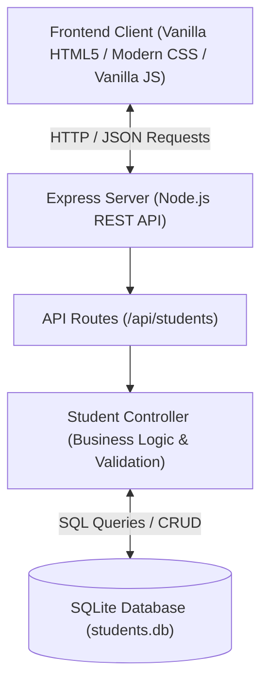

# 🎓 EduPulse - Student Management System
### Full Stack Development Internship — Task 2 (Easy) | Auspify Technologies

[](https://nodejs.org/)
[](https://expressjs.com/)
[](https://www.sqlite.org/)
[](https://developer.mozilla.org/)
[](LICENSE)

---

## 📌 Project Overview

**EduPulse** is a responsive full-stack **Student Management System** built for **Task 2** of the **Auspify Technologies Full Stack Development Internship Program**. The application provides an end-to-end institutional solution for managing student admissions, tracking academic performance, querying records, and analyzing departmental distribution.

### 📋 Task Specifications & Completed Milestones

| Step | Milestone | Implementation Status | Details |
|---|---|:---:|---|
| **Step 1** | **Design the frontend interface** | ✅ Completed | Responsive layout with Glassmorphism, tailored color palettes, dark/light theme toggle, stat cards, dynamic data tables, and modal dialogs. |
| **Step 2** | **Create backend APIs** | ✅ Completed | Modular Express REST APIs handling CRUD operations, analytics aggregation, and data export. |
| **Step 3** | **Implement database connectivity** | ✅ Completed | Embedded SQLite database with automatic table creation, constraints, indexing, and seed data. |
| **Step 4** | **Add CRUD operations** | ✅ Completed | Complete Create, Read, Update, and Delete workflows with field validation and toast notifications. |
| **Step 5** | **Test application functionality** | ✅ Completed | Automated integration test suite validating 100% of endpoints. |

---

## ✨ Key Features

1. **Student Record Management (CRUD)**:
   - **Add Students**: Register new students with Student ID, First/Last Name, Email, Phone, Department, GPA, Academic Status, Gender, Avatar, and Residential Address.
   - **Update Records**: Edit any student details with pre-populated inputs and instant constraint validation.
   - **Delete Records**: Safe deletion flow with custom confirmation modal.
   - **View Student Details**: Detailed student transcript profile card showing status badge, GPA tier, and contact information.

2. **Dashboard Analytics & Statistics**:
   - Live KPI cards: Total Students, Active Students, Average Institutional GPA, and Active Academic Departments.
   - Department enrollment distribution progress metrics with real-time percentages.

3. **Smart Search & Filters**:
   - Real-time search by Student Name, ID, or Email address.
   - Filter by Academic Department (Computer Science, Data Science, Software Engineering, etc.).
   - Filter by Academic Status (Active, Graduated, Probation, On Leave).
   - Dynamic sorting by ID, Name, GPA, Department, or Enrollment Date (Ascending/Descending).

4. **Data Portability & Utilities**:
   - One-click **Export to CSV** for spreadsheet analysis.
   - One-click **Export to JSON** for backups.
   - **Reset Sample Data** utility button to restore default demo records anytime.
   - **Dark / Light Theme**: Instant theme switcher with localStorage persistence.

---

## 🏗️ System Architecture & Tech Stack



- **Frontend**: Semantic HTML5, Vanilla CSS3 (Custom design system, CSS variables, glassmorphism, responsive Grid/Flexbox), Vanilla JavaScript (ES6+ async/await, DOM events, Client-side filtering).
- **Backend**: Node.js & Express.js (REST API, CORS, Body-parser, Morgan logging).
- **Database**: SQLite3 relational embedded storage (zero-configuration, persistent file storage).
- **Icons & Typography**: Font Awesome 6, Plus Jakarta Sans (Google Fonts).

---

## 🚀 Getting Started

### Prerequisites

Ensure you have [Node.js](https://nodejs.org/) installed (v18.0.0 or higher).

### Installation & Run

1. **Clone the repository**:
   ```bash
   git clone https://github.com/SandunDey/student-management-system.git
   cd student-management-system
   ```

2. **Install dependencies**:
   ```bash
   npm install
   ```

3. **Start the application**:
   ```bash
   npm start
   ```

4. **Open in browser**:
   Navigate to:
   ```
   http://localhost:3000
   ```

---

## 🧪 Running Automated Tests

A dedicated test suite is included to verify all REST API endpoints and CRUD operations:

```bash
npm test
```

### Test Suite Output Sample
```
--- Starting Student Management System API Tests ---
[PASS] 1. Server Health Check API
[PASS] 2. Fetch Dashboard Statistics API
[PASS] 3. GET /api/students list
[PASS] 4. POST /api/students Create Student
[PASS] 5. GET /api/students/:id View Student Details
[PASS] 6. PUT /api/students/:id Update Student Record
[PASS] 7. Verify Updated Values in Database
[PASS] 8. DELETE /api/students/:id Delete Student
[PASS] 9. Confirm Student Record No Longer Exists (404)

===============================================
Test Results: 9/9 passed (100%)
===============================================
```

---

## 📡 REST API Reference

| Method | Endpoint | Description | Request Body |
|---|---|---|---|
| `GET` | `/api/students` | Get all students (supports query params: `search`, `department`, `status`, `sortBy`, `order`, `page`, `limit`) | None |
| `GET` | `/api/students/stats` | Get KPI metrics and departmental breakdown | None |
| `GET` | `/api/students/:id` | Get single student details by ID | None |
| `POST` | `/api/students` | Create a new student record | `{ student_id, first_name, last_name, email, phone, department, enrollment_date, gpa, status, gender, avatar_url, address }` |
| `PUT` | `/api/students/:id` | Update an existing student record | `{ first_name, last_name, email, phone, department, enrollment_date, gpa, status, gender, avatar_url, address }` |
| `DELETE` | `/api/students/:id` | Delete a student record | None |
| `POST` | `/api/students/reset/seed` | Reset database to default sample records | None |
| `GET` | `/api/health` | Service health status check | None |

---

## 📂 Project Structure

```
student-management-system/
├── controllers/
│   └── studentController.js   # API business logic, queries, and validation
├── database/
│   ├── db.js                  # SQLite connection, schema initialization & seed data
│   └── students.db            # Persistent SQLite database file
├── public/
│   ├── css/
│   │   └── style.css          # Design system, glassmorphism, responsive styles & themes
│   ├── js/
│   │   └── app.js             # Client SPA controller, fetch requests, modals, exports
│   └── index.html             # Main dashboard UI structure & modal definitions
├── routes/
│   └── studentRoutes.js       # Express route definitions
├── tests/
│   └── api.test.js            # Automated integration test suite
├── .gitignore
├── package.json
├── README.md
└── server.js                  # Express application entry point
```

---

## 👤 Author & Submission

- **Internship Program**: Auspify Technologies Full Stack Development
- **Task**: Task 2 (Easy) – Student Management System
- **Repository**: [https://github.com/SandunDey/student-management-system](https://github.com/SandunDey/student-management-system)